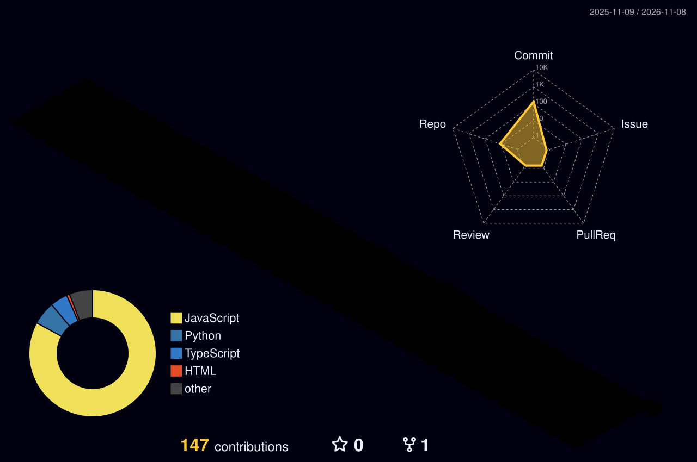

<div align="center">



<a href="https://git.io/typing-svg">
  
</a>

<p>B.Tech Information Science &amp; Engineering student who loves exploring technology<br/>and turning ideas into code.</p>

<a href="https://linkedin.com/in/manisha-gp"></a>
<a href="mailto:manishagpsrg@gmail.com"></a>
<a href="https://instagram.com/_manish2510_"></a>
<a href="https://x.com/ManishaGP252607"></a>
<a href="https://discord.gg/DKDQb6c4"></a>
<a href="https://pinterest.com/manishagpsrg"></a>
<a href="https://stackoverflow.com/users/29317962"></a>
<br/><br/>


</div>


## ◈ About Me

```text
> role      : B.Tech (ISE) student
> focus     : problem solving, coding, building small but meaningful projects
> mindset   : curious, consistent, always learning
> fuel      : tea + music
```


## ◈ Tech Stack

<!--
  EDIT ME: every icon is just an id in the URL. Delete ids you don't use, add ones you do.
  Full id list: https://github.com/tandpfun/skill-icons#icons-list
-->

<table align="center">
<tr><td align="right"><b>Languages</b></td><td></td></tr>
<tr><td align="right"><b>Frontend</b></td><td></td></tr>
<tr><td align="right"><b>Backend</b></td><td></td></tr>
<tr><td align="right"><b>Databases</b></td><td></td></tr>
<tr><td align="right"><b>Cloud</b></td><td></td></tr>
<tr><td align="right"><b>AI / ML</b></td><td></td></tr>
<tr><td align="right"><b>Tools</b></td><td></td></tr>
</table>


## ◈ Featured Projects

<!-- EDIT ME: replace YOUR-REPO / titles / descriptions. Delete a card you don't need. -->

<table align="center">
<tr>
<td width="50%" valign="top">

**Project One**<br/>
<sub>This is our Final Year Project focusing on optimal routing by considering geo spatial constraints</sub><br/><br/>
 <br/>
<a href="[https://github.com/manish-g-p/YOUR-REPO](https://github.com/manish-g-p/optimal-ship-routing)">Optimal Ship Routing</a> &nbsp;|&nbsp;

</td>
<td width="50%" valign="top">

**Project Two**<br/>
<sub>A full-stack MERN application that turns a resume and a job description into a personalised interview strategy.</sub><br/><br/>
 <br/>
<a href="[https://github.com/manish-g-p/YOUR-REPO](https://github.com/manish-g-p/prepwise-ai-coach)">Prepwise-ai-coach</a> &nbsp;|&nbsp; 

</td>
</tr>
<tr>
<td width="50%" valign="top">

**Project Three**<br/>
<sub>CarePulse is a self-hosted, privacy-focused healthcare app that turns consented doctor–patient conversations into encrypted, speaker-labeled, multilingual transcripts and clinical summaries.</sub><br/><br/>
 <br/>
<a href="[https://github.com/manish-g-p/YOUR-REPO](https://github.com/manish-g-p/carepulse-mern)">Carepulse</a> &nbsp;|&nbsp; 


</tr>
</table>


## ◈ GitHub Statistics

<div align="center">



<br/>



</div>


## ◈ 3D Contribution Graph

<div align="center">
<picture>
  <source media="(prefers-color-scheme: light)" srcset="profile-3d-contrib/profile-green.svg">
  
</picture>
</div>


## ◈ Contribution Snake

<div align="center">
<picture>
  <source media="(prefers-color-scheme: dark)" srcset="https://raw.githubusercontent.com/manish-g-p/manish-g-p/output/github-snake-dark.svg">
  <source media="(prefers-color-scheme: light)" srcset="https://raw.githubusercontent.com/manish-g-p/manish-g-p/output/github-snake.svg">
  
</picture>
</div>


## ◈ Currently Learning

<!-- EDIT ME: replace with what you're actually learning right now. -->

```text
[ ] Data Structures & Algorithms    
[ ] Backend Engineering              
[ ] Databases                        
[ ] DevOps & Cloud                   
[ ] System Design Fundamentals      
[ ] Software Quality                 
```

## ◈ Developer Activity

<div align="center">


</div>


## ◈ Contact

<div align="center">

Open to collaborating, learning together, and building cool things.<br/>
<a href="mailto:manishagpsrg@gmail.com">manishagpsrg@gmail.com</a> &nbsp;|&nbsp; <a href="https://linkedin.com/in/manisha-gp">LinkedIn</a>


</div>
